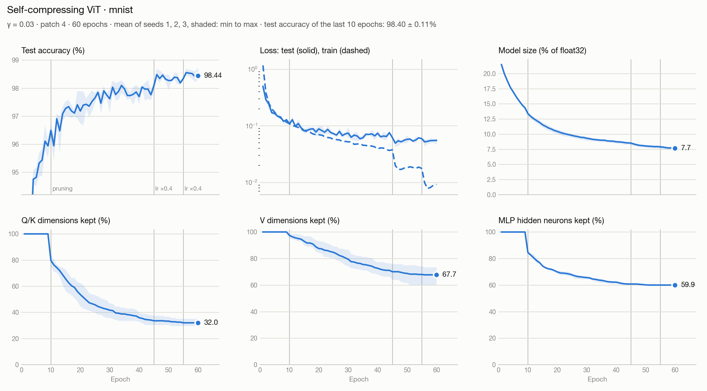

# Self Compressing Vision Transformer
---
This repo is a PyTorch implementation of a Self-Compressing Vision Transformer, based on the [SelfCompress](https://github.com/nath73000/SelfCompressingNeuralNetwork) library.

---
# Installation
```bash
pip install -r requirements.txt
```
MNIST is downloaded into `data/` on the first run.

---
# Usage
```bash
python train.py --config configs/mnist.yaml                                    # one run
python train.py --config configs/mnist.yaml --set training.gamma=0.05 seed=2   # change any value of the config
python plot_runs.py                                                            # plot the most recent run
```
Each run is saved in `runs/<dataset>/<date>_g<gamma>_s<seed>/`, with its config and one row of metrics per epoch.
`configs/mnist.yaml` trains on an Apple GPU (`device: mps`): add `--set device=cpu` on another machine.

---
# How it works
All linear layers of the Vision Transformer are `SelfCompressingLinear` layers.
In addition to the weights and biases, two parameters are learned by backpropagation for each neuron:
- The number of bits used to encode its weights (`bits` parameter)
- The step between two quantization levels, which is 2 to the power `exponent` (`exponent` parameter)

A neuron whose number of bits reaches 0 is removed. This can happen to the queries, keys and values of each head and to the hidden neurons of the MLPs.
The neurons that set the embedding dimension (patch embedding, output projection of the attention, output of the MLPs) and the classifier are quantized but never removed.

Only the weights are quantized: the biases and the LayerNorm parameters stay in float32.

---
# How the size is counted
The model size logged by `train.py` (`model_size_kb`, `pct_model_size_vs_fp32`, "vs FP32" in the console) counts everything needed to store the model:
- The weights of each neuron, on a whole number of bits
- One bit-width (1 byte) and one exponent (float32) per neuron still in use
- Every bias and LayerNorm parameter, in float32

It is compared to the same model stored entirely in float32.
`bits_per_weight` and `pct_size_vs_fp32` only count the weights, with continuous bit-widths: this is what the compression loss sees.

---
# Results


| Dataset | Test accuracy | Model size | Compression | Q/K kept | V kept | MLP hidden kept |
|---|---|---|---|---|---|---|
| MNIST | 98.40 ± 0.11% | 20.6 KB (float32: 269 KB) | ×13 | 32% | 68% | 60% |

Mean ± standard deviation over 3 seeds (1, 2, 3) with `configs/mnist.yaml`: patch 4, embedding 64, 4 heads, 2 blocks, MLP hidden 128, γ = 0.03, 60 epochs, pruning from epoch 10, learning rates ×0.4 at epochs 45 and 55.
The test accuracy is the average of the last 10 epochs, because it moves by a few tenths of a point from one epoch to the next (final epoch: 98.44 ± 0.25%).
Of the 20.6 KB, 12.7 KB are weights and 7.9 KB are biases, LayerNorm parameters, bit-widths and exponents.

The network chooses its own shape. Queries and keys shrink the most: only 2 to 8 of the 16 dimensions of each head are left, against 4 to 15 for the values.
The MLP keeps 86 to 90 of its 128 hidden neurons in the first block, and 63 to 66 in the second.

Reproduce (about 27 minutes per run on CPU, one thread per run):
```bash
for seed in 1 2 3; do OMP_NUM_THREADS=1 python train.py --config configs/mnist.yaml --set seed=$seed device=cpu & done; wait
python plot_runs.py --mean runs/mnist/*_s1 runs/mnist/*_s2 runs/mnist/*_s3 --out assets/mnist_training.png
```
